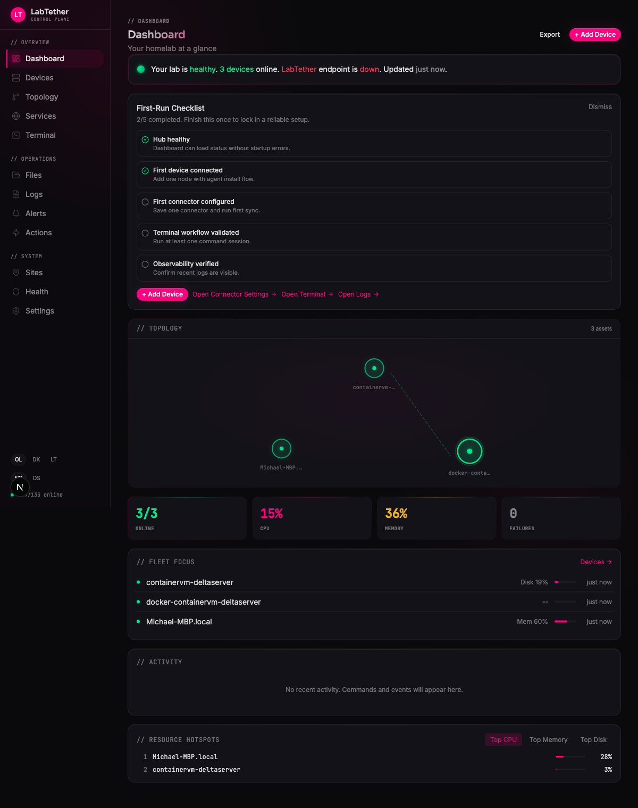
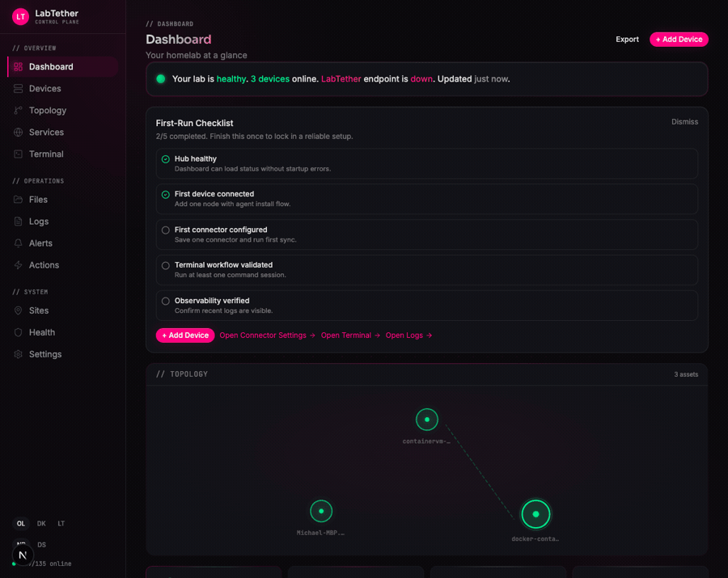
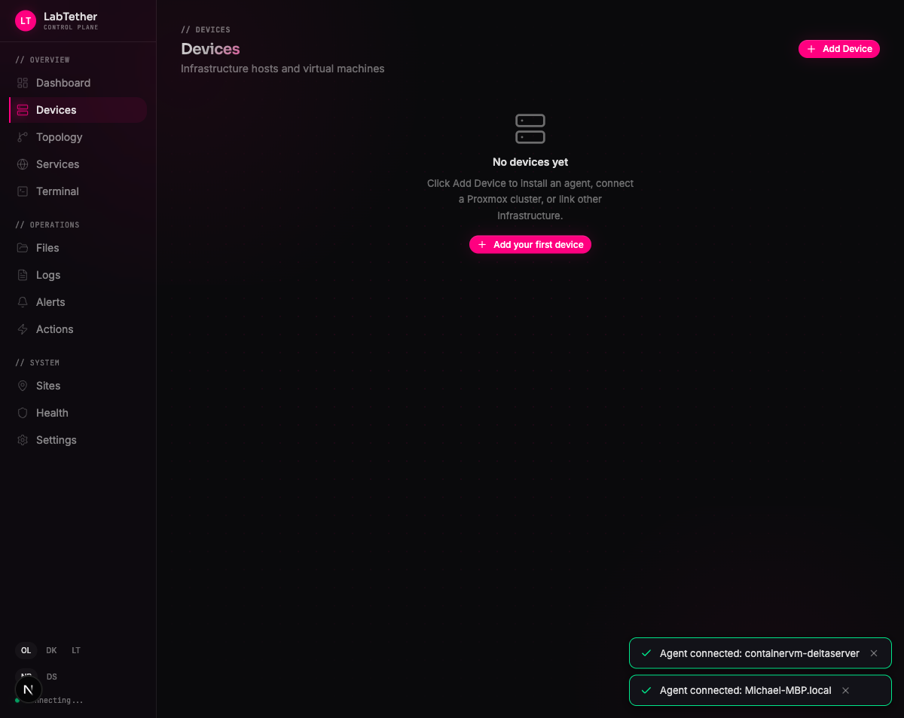
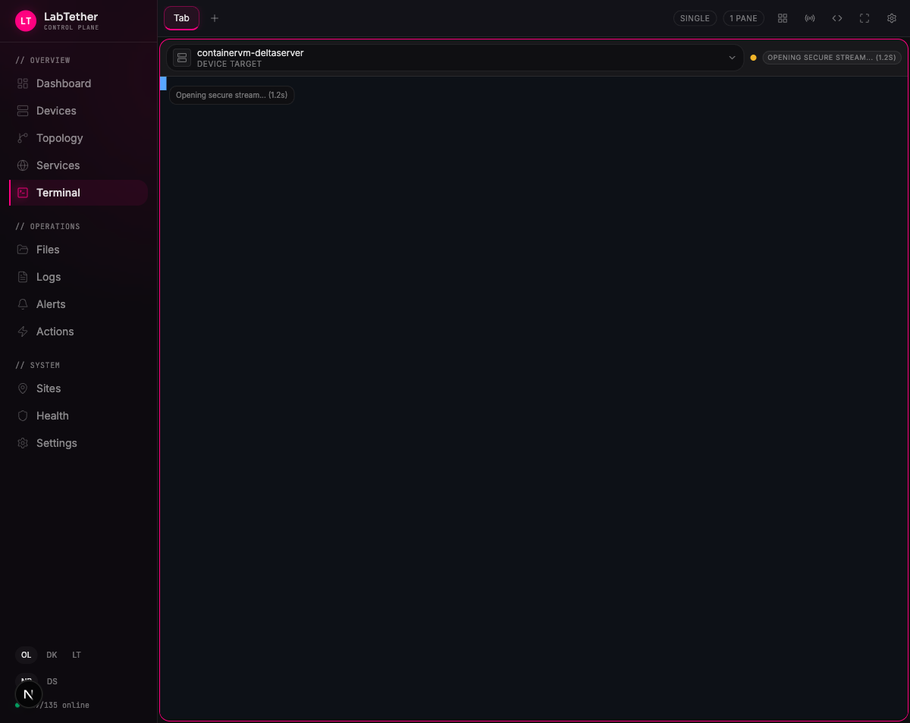
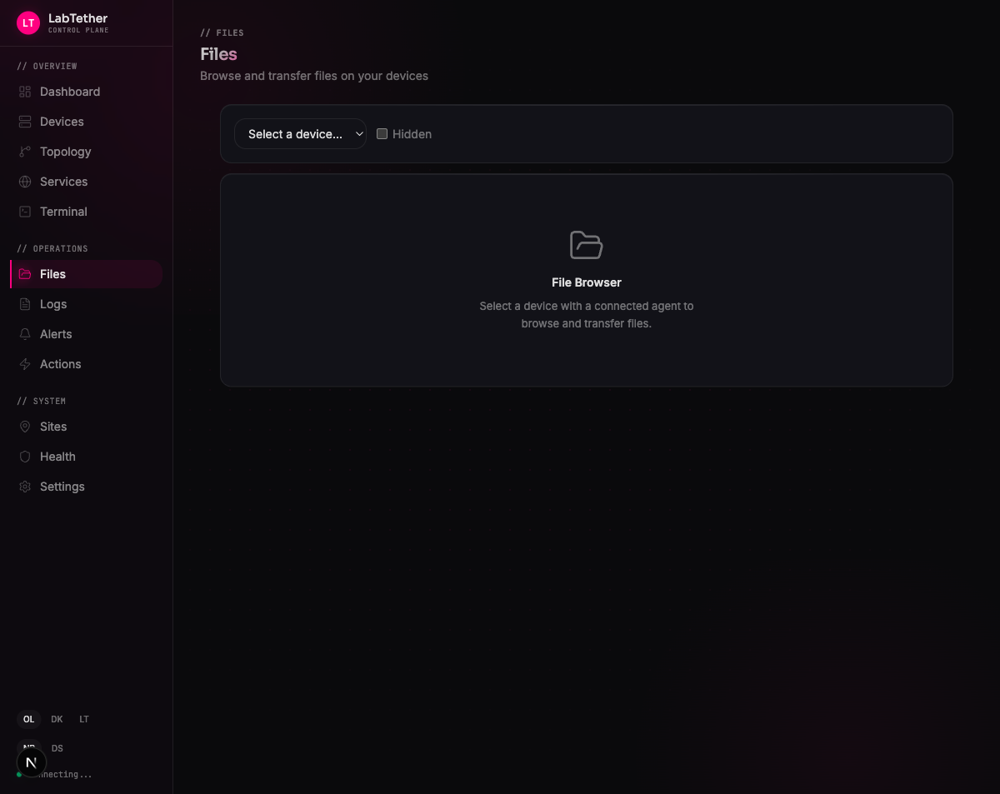
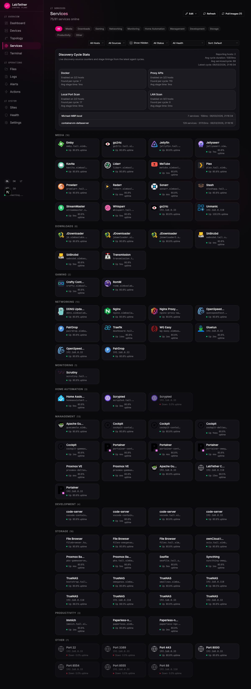
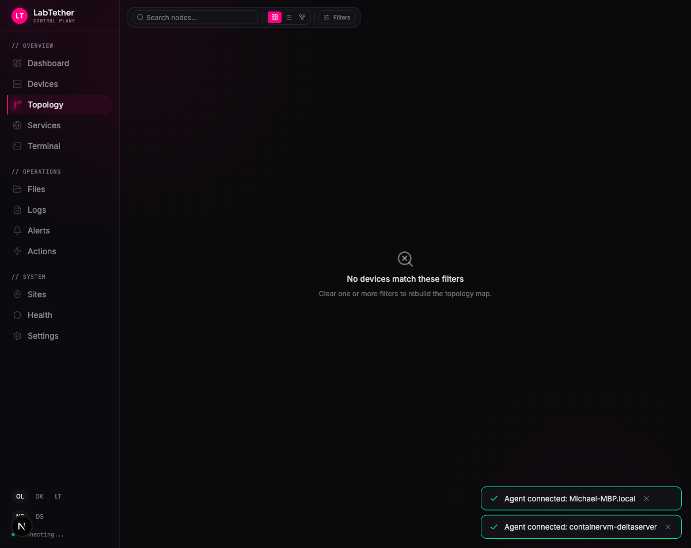
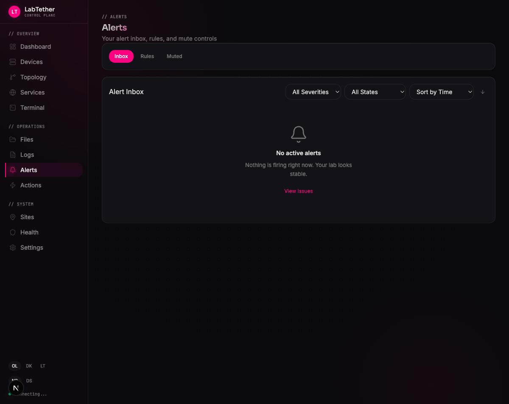
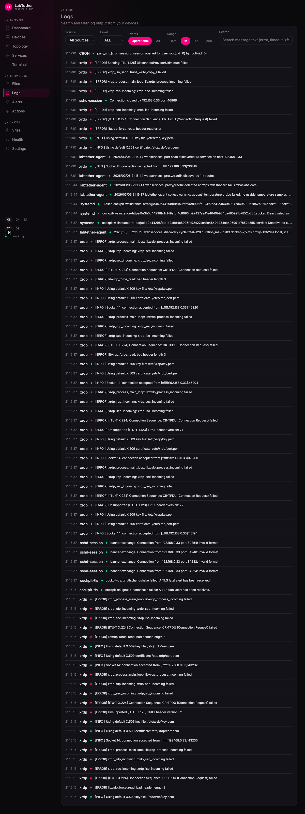
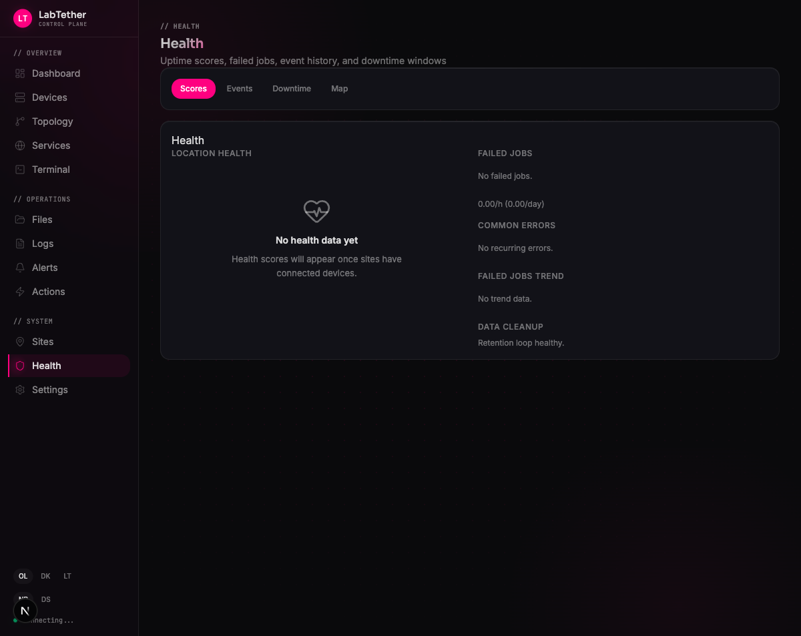

<div align="center">


# LabTether

**One self-hosted hub for every machine, VM and container in your homelab.**

[](https://github.com/labtether/labtether/actions/workflows/ci.yml)
[](LICENSE)
[](https://discord.gg/Be6Fa9hv)

[Live demo](https://demo.labtether.com) &middot; [Docs](https://labtether.com/docs) &middot; [Website](https://labtether.com) &middot; [Discord](https://discord.gg/Be6Fa9hv)

</div>

<p align="center">
  
</p>

You already run Proxmox, TrueNAS, Docker and maybe Home Assistant. Each one has
its own login, its own dashboard and its own alerts. When a disk starts failing
at 2 AM, you end up with five tabs open, trying to piece together what happened.

LabTether brings it all into one hub. Every node, VM, container, alert and log
is on one screen, and you can open a terminal or a remote desktop on any
machine from the same page. It runs on your own hardware, so your data stays on
your network.

## What you get

- **Every device on one dashboard.** CPU, memory, disk, network and temperature
  for each node, with its VMs and containers beside it.
- **Works with what you already run.** Connect Proxmox VE, Proxmox Backup
  Server, TrueNAS, Docker, Portainer and Home Assistant with an API key.
  Nothing to install on them.
- **Terminal and remote desktop in the browser.** Open a shell, or a VNC, RDP,
  SPICE or WebRTC desktop, on any node. Agent nodes need no SSH keys.
- **Alerts you can act on.** Alert rules, notification routes and maintenance
  silences. Group related alerts into an incident and track it to the fix.
- **Day-to-day jobs in one place.** Move files between machines, restart
  services, search logs and roll out package updates with a dry run first.
- **A map of what depends on what.** The topology view shows what else goes
  down before you reboot something.
- **Automation.** Save a command once, then run it on a group or on a schedule.
  Webhooks send hub events to your other tools.
- **Ask your AI agent.** The built-in MCP server gives Claude, Cursor or any MCP
  client 32 tools for your homelab. Each API key has its own scopes, so an
  agent can only touch what you allow.
- **Locked down from day one.** HTTPS from first boot, 2FA, single sign-on
  (OIDC), owner, admin, operator and viewer roles, and an audit log. Tailscale
  Serve puts the hub on your tailnet without opening a port.
- **Open source.** The hub is Apache 2.0 and runs with Docker Compose.

<p align="center">
  
</p>

## Try it

Click around the [live demo](https://demo.labtether.com). No sign-up.

## Install

You need Docker with Compose 2.33.1 or newer.

```bash
curl --proto '=https' --tlsv1.2 -fsSLo install-labtether.sh https://labtether.com/install.sh
less install-labtether.sh   # read it before you run it
LABTETHER_VERSION=vX.Y.Z bash install-labtether.sh
```

Use the version from the [latest release](https://github.com/labtether/labtether/releases/latest).
The installer checks the release checksums and starts pinned images. When it
finishes, open <http://localhost:3000> and the setup wizard takes it from there.

External Postgres, custom TLS and other options are in the
[installation guide](https://labtether.com/docs/getting-started/installation).

## Add your machines

Mix both kinds as you like.

**Connectors** cover Proxmox VE, Proxmox Backup Server, TrueNAS, Docker,
Portainer and Home Assistant. You give the hub an API key and it finds your
VMs, pools and containers. See [connectors](https://labtether.com/docs/guides/connectors).

**Agents** add live metrics, terminal, desktop, files and actions on a machine.
In the hub, click **Add Device** and copy the command for your OS. See
[your first node](https://labtether.com/docs/getting-started/first-node).

| Platform | Status | Get it |
|---|---|---|
| Linux (amd64, arm64) | Supported | [labtether-agent](https://github.com/labtether/labtether-agent) |
| macOS 13+ | Supported | [Menu bar app](https://github.com/labtether/labtether-mac) |
| Windows 10+ (amd64, arm64) | Partial. Metrics and terminal work; more is in progress. | [labtether-agent](https://github.com/labtether/labtether-agent). A [tray app](https://github.com/labtether/labtether-win) is on the way. |
| FreeBSD | Planned | For now, add it as a manual device and reach it over SSH |

Full details: [platform support](https://labtether.com/docs/reference/platform-support).

## More ways in

- **[CLI](https://github.com/labtether/labtether-cli):** run your hub from a terminal or a script.
- **[MCP](https://labtether.com/docs/gateway/mcp):** point Claude, Cursor or any MCP client at `https://your-hub:8443/mcp`.
- **[REST API](https://labtether.com/docs/gateway/api-reference):** scoped API keys and a built-in OpenAPI reference.
- **[Home Assistant](https://github.com/labtether/labtether-homeassistant):** your hub's devices as Home Assistant sensors and switches.
- **iPhone and iPad:** a native app is on the way.

## Screenshots

<details>
<summary>Show all screenshots</summary>
<br/>
<p align="center">
  <br/>
  <em>Device detail</em>
</p>
<p align="center">
  <br/>
  <em>Terminal with snippets and bookmarks</em>
</p>
<p align="center">
  <br/>
  <em>Files across machines</em>
</p>
<p align="center">
  <br/>
  <em>Services with health checks</em>
</p>
<p align="center">
  <br/>
  <em>Topology</em>
</p>
<p align="center">
  <br/>
  <em>Alerts</em>
</p>
<p align="center">
  <br/>
  <em>Logs</em>
</p>
<p align="center">
  <br/>
  <em>Health</em>
</p>
</details>

## Help

- [Docs](https://labtether.com/docs)
- [Known issues](KNOWN_ISSUES.md) and [support](SUPPORT.md)
- [Changelog](CHANGELOG.md)
- [Security policy](SECURITY.md) and [closed CVEs](https://github.com/labtether/labtether/issues?q=is%3Aissue%20is%3Aclosed%20label%3Acve)
- [GitHub Discussions](https://github.com/labtether/labtether/discussions) and [Discord](https://discord.gg/Be6Fa9hv)

## Contributing

[CONTRIBUTING.md](CONTRIBUTING.md) gets you set up. If you work with an AI
coding agent, point it at [AGENTS.md](AGENTS.md) first. It has the repo map,
the checks to run and the house rules. Architecture notes are in
[docs/internal/](docs/internal/).

## License

[Apache 2.0](LICENSE). Copyright 2026 LabTether.
